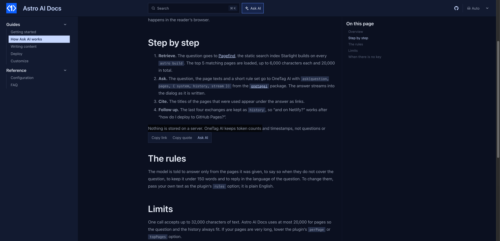

# starlight-share-highlight

Select any text on a [Starlight](https://starlight.astro.build) page and copy a link that opens the page **scrolled to that exact sentence, with it highlighted**. Or copy it as a quote with the link attached. Free, no account, no backend.



- **Copy link.** Heading anchors only get people to a section. This gets them to the sentence: paste the link in an issue, a chat or a review and the reader lands on the highlighted text.
- **Copy quote.** Puts a Markdown blockquote with a link back to the source on the clipboard, ready for GitHub, Discord or your notes.
- **Nothing to host.** Links use the browser's own text fragments (`#:~:text=`), supported in Chrome, Edge, Safari and Firefox. Older browsers simply open the page.
- The toolbar appears above the selection and closes with Esc.
- Text in English, 简体中文, 日本語, Español, Français, Deutsch, Português and 한국어, following the page language.
- **Optional AI switch**: with `ai: true`, an **Ask AI** button explains the selected text using the page as context.

## Install

```bash
npm install starlight-share-highlight
```

```js
// astro.config.mjs
import { defineConfig } from "astro/config";
import starlight from "@astrojs/starlight";
import starlightShareHighlight from "starlight-share-highlight";

export default defineConfig({
  integrations: [
    starlight({
      title: "My docs",
      plugins: [starlightShareHighlight()],
    }),
  ],
});
```

## Options

| Option | Default | What it does |
| --- | --- | --- |
| `actions` | `["link", "quote"]` | Buttons to show. Add `"x"` for a button that opens a post on X with the quote and link. |
| `minChars` | `3` | Shortest selection that shows the toolbar. |
| `maxChars` | `1500` | Longest selection that shows the toolbar. |
| `labels` | built-in | Override text, e.g. `{ link: "Link to this" }`. |
| `ai` | `false` | `true` (or `{ key }`) adds an Ask AI button. |

## The AI switch

```js
starlightShareHighlight({ ai: true })
```

An **Ask AI** button joins the toolbar; one click explains the selected text in plain words, using the rest of the page as context. It runs in the browser through [OneTag AI](https://onetagai.com/?ref=starlight-share-highlight); on localhost it works right away on a shared demo key. A deployed site needs a free key, set as `PUBLIC_ONETAG_KEY` in `.env` or `ai: { key: "ot_..." }`: enter an email at onetagai.com and the key arrives in your inbox, no password, no card. The AI code loads only when a reader clicks.

With the switch off (the default) nothing AI-related is loaded.

## More for Starlight

- [starlight-page-feedback](https://github.com/fengyiqicoder/starlight-page-feedback): "Was this page helpful?", sent to the analytics you already run.
- [starlight-reading-time](https://github.com/fengyiqicoder/starlight-reading-time): reading time, last updated and an outdated note under every page title.
- [starlight-glossary](https://github.com/fengyiqicoder/starlight-glossary): define a term once and readers get its definition in a tooltip wherever it appears, plus a glossary page.
- [starlight-onetag](https://github.com/fengyiqicoder/starlight-onetag): Ask AI, AI answers in search, page translation for readers, Explain this code.

## License

MIT.
